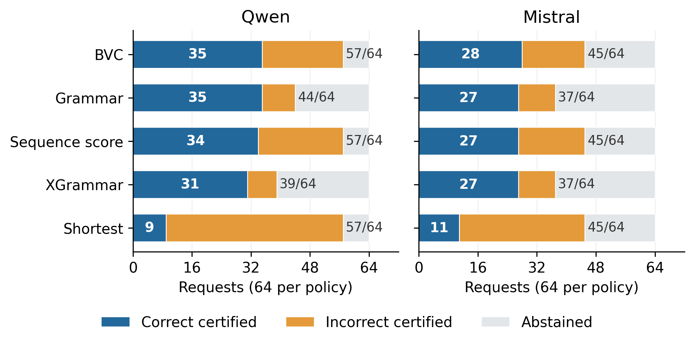

# Budget-viable commitment for finite-language decoding under hard token budgets

**Authors:** Ya Bai, GuoZhen Bian, Cheng Chang, ZhengGuang Cui, HaiLong Qin, ZhiHui Huang, Yue Wang

China Telecom Cloud Network Operating System R&D Center, Beijing, China

**Correspondence:** biangz@chinatelecom.cn

## Abstract

Grammar-legal generation can still enter a state from which no accepted output fits the remaining token budget. We present budget-viable commitment (BVC), a contract-explicit refinement of constrained decoding over declared finite token languages. BVC retains next tokens with a budget-feasible accepting continuation and validates the artifact before commitment. We characterize feasible support and prove conditional completion and exact preservation of already successful matched greedy grammar trajectories. Two-model experiments use 96 known ARC-Challenge questions and a later 64-question subset. At the original 24-token setting, the filter is inactive and correct-commit counts are unchanged. At an exploratory eight-token setting, BVC completes all initially feasible requests: 57/57 versus 44/57 for grammar-only on Qwen and 45/45 versus 37/45 on Mistral. It avoids 13 and eight newly entered canonical budget dead ends while preserving all successful grammar trajectories. Correct commitments increase by zero and one, because 20 of 21 additional completions have over-budget canonical reference paths. Candidate scoring matches structural coverage but retains only 41/44 and 35/37 successful Grammar answers. A weaker text-only certificate changes some comparisons. These results establish a local control advantage over the evaluated grammar-only policy, together with explicit semantic and terminal-policy boundaries. BVC provides trajectory-preserving budget control, not a general accuracy or speed advantage over all constrained-generation methods.

**Keywords:** constrained decoding; token budgets; finite languages; trajectory preservation; verified completion

## Introduction

A generation limit and an acceptance guarantee solve different problems. A language model may produce only grammar-legal prefixes yet spend its final token on a branch that still requires a closing suffix. Conversely, an answer can be locally complete while the declared artifact remains unfinished. Applications with hard output limits need to distinguish a permitted next token from one that leaves an accepted ending reachable.

We study *budget-viable commitment* (BVC): append-only completion in a declared finite token language, with bound fields and an explicit commitment check. At each completion step, BVC retains a token only if the resulting state has an accepting continuation inside the remaining token budget. The model selects among the retained tokens. The controller need not choose the shortest answer; it removes paths that cannot satisfy the declared completion requirement in time.

Our central claim is specific. Relative to greedy grammar-only decoding with the same language, prefix, budget, model scores and tie-breaking, BVC prevents budget-infeasible continuations while leaving every already successful trajectory unchanged. This is a structural control property. It neither establishes the truth of a selected answer nor ensures that all valid text representations belong to the declared language. Those distinctions are important when evaluating an apparent gain in completion coverage.

The paper makes three contributions:

1.  **Contract-explicit budget control.** We formulate the relation between bound-field preservation, controller acceptance, remaining-budget feasibility and final text validation, and give conditional completion guarantees.

2.  **Successful-trajectory preservation.** We prove that exact budget filtering preserves every matched greedy grammar trajectory that already accepts within budget. A deterministic reduction and a semantic counterexample identify when model-guided completion can and cannot add value.

3.  **Measured advantages and failure boundaries.** A source-linked raw-record analysis with two models demonstrates improved canonical completion and fewer budget dead ends over grammar-only, alongside unchanged or minimally changed correct yield, strong candidate-scoring baselines, and terminal-policy sensitivity.

The contribution combines a precise control specification, its preservation analysis and a reproducible mechanism study. It does not rely on inventing a new shortest-distance recurrence or on outperforming every comparator on every metric.

Three research questions connect the contributions to evidence. RQ1 concerns conditional completion and trajectory preservation. RQ2 concerns canonical dead-end avoidance and computational work. RQ3 concerns the relation between additional structural completions and answer correctness. The original 24-token comparison and all unfavorable outcomes remain part of the evaluation; the tighter-budget and diagnostic analyses are exploratory.

## Related work and positioning

Lexically constrained decoding and grammar-constrained generation enforce output restrictions during decoding (Hokamp and Liu 2017; Geng et al. 2023). Outlines and XGrammar provide practical structured-generation mechanisms (Willard and Louf 2023; Dong et al. 2024). These are relevant foundations and comparators: structural control itself is established, and a finite-state engine using the same transitions, accepting set, distance filter and scoring rule can reproduce BVC.

Length control is also established. LMQL combines output constraints and control flow (Beurer-Kellner, Fischer, and Vechev 2023); its documented token-length operators and eager token masking support length-bounded generation (LMQL contributors 2026). BVC is therefore not positioned as the first combination of constraints and token limits. Its focus is the explicit accepting-distance condition in a declared finite token language and the consequences of that condition for successful greedy trajectories and commitment endpoints.

Lookahead-constrained search similarly reasons about future constraint satisfaction. NeuroLogic A\*esque uses lookahead heuristics to guide constrained generation (Lu et al. 2022). Our distance oracle is exact inside a finite compiled language, rather than a heuristic quality estimate over unrestricted output. Exactness is relative to that language; it provides no global best-sequence or factual-correctness guarantee.

Budget-aware reasoning studies the allocation and sufficiency of inference effort (Wang et al. 2024; Han et al. 2025; Muennighoff et al. 2025). Here the budget counts additional output tokens needed to reach structural acceptance. A structurally feasible answer can be wrong, and a correct reference answer can be excluded by its serialized length.

The empirical comparison is scoped to the evaluated implementations. The grammar-only adapter masks illegal trie edges and relies on the generation cap. The BVC adapter additionally checks remaining accepting distance. The XGrammar 0.1.21 adapter compiles finite suffix strings without a remaining-distance argument to its matcher (XGrammar contributors 2026). Candidate scoring filters over-budget canonical paths before scoring complete sequences; deterministic shortest completion also respects feasibility. Thus structural completion is shared with strong non-generative alternatives. Our claim is a demonstrated refinement of the matched grammar-only policy and a characterization of its trade-offs, rather than priority over all length-aware constraint systems or a benchmark ranking of untested libraries.

## Budget-viable commitment

### Contracts, languages and commitment

Let $x$ be the prompt, $y$ the output prefix, $V_{\mathcal C}(y)$ a final consumer-text predicate, and $P_b(y)$ preservation of values fixed by a binding rule $b$. Neither predicate is a reference-answer oracle. A compiler constructs a token controller with state $s$, partial transition $\delta(s,v)$ and accepting set $\mathcal F$. Every accepting path must decode to an artifact satisfying $V_{\mathcal C}$ and $P_b$. This is a soundness requirement, not completeness over all artifacts accepted by the consumer.

The operational states are DRAFT, REPAIR, COMMIT and ABSTAIN. BIND is a transition that fixes values and constructs a completion language. The implementation is append-only: it cannot rewrite earlier fields or roll back the key–value cache. The supplied-prefix interface starts directly in the compiled language; the wrapper interface first recognizes a candidate during drafting.

Native controller acceptance and final text validity are distinct. Commitment requires the controller to reach an accepting state and pass final checks. A prefix can satisfy a weaker text predicate before the controller accepts. In the evaluated finite-choice protocol, compiled paths include a terminal newline, whereas the final text checker permits its omission through trailing-whitespace normalization. We retain the frozen controller-certified endpoint and report the weaker text-only endpoint separately in Section 5.7. This distinction prevents a controller-termination difference from being interpreted as a general consumer-quality advantage.

### Exact viability and model selection

For total output allowance $B$ and $t$ already generated tokens, the remaining allowance is $r=B-t$. In supplied-prefix experiments, $r$ counts only newly completed suffix tokens; the supplied prefix is excluded from this token cap. Its processing cost remains part of measured requests. Each transition consumes one token. Acceptance returns immediately without another EOS token; a nonaccepting repair does not permit EOS.

Define accepting distance inside the declared language as $$d(s)=\min\{|z|:\delta^*(s,z)\in\mathcal F\},$$ with $d(s)=\infty$ if acceptance is unreachable and $d(s)=0$ at accepting states. For nonaccepting $s$ and $r>0$, BVC permits $$\mathcal A_r(s)=\{v:\delta(s,v)\text{ is defined},\ d(\delta(s,v))\le r-1\}.$$ Distances count model tokens, not bytes or characters. A finite list of canonical paths may omit other tokenizations and valid artifacts, so its minimum is not a global minimum over the consumer’s entire accepted text space.

For positive normalizer $Z$, the masked distribution is $$q_r(v\mid x,y,s)=\frac{p_\theta(v\mid x,y)\mathbf1\{v\in\mathcal A_r(s)\}}{Z}.$$ Here $Z=\sum_u p_\theta(u\mid x,y)\mathbf1\{u\in\mathcal A_r(s)\}$. The implementation selects the greedy maximum among permitted finite scores. An empty finite-score support or invalid permitted scores produces an explicit failure. This local mask does not claim to sample from the language model conditioned on eventual global acceptance.

### Completion and preservation guarantees

**Proposition 1 (Feasible first-token characterization).** For a nonaccepting state and $r>0$, a legal token belongs to $\mathcal A_r(s)$ if and only if an accepting continuation of at most $r$ tokens begins with that token.

*Proof.* If the token survives, its successor has an accepting suffix of at most $r-1$ tokens. Conversely, removing the first token of any accepting continuation of length at most $r$ supplies such a suffix. $\square$ Consequently, the mask retains all structurally feasible first tokens inside this language. It is maximally permissive for this feasibility condition, not for arbitrary consumer-valid text or semantic quality.

**Proposition 2 (Conditional budget-bounded acceptance).** Suppose repair starts with $d(s_0)\le r_0$. With exact transitions and distances, selection restricted to $\mathcal A_r$, a permitted token with finite model score at every nonaccepting step, and successful execution, acceptance occurs within $r_0$ new tokens.

*Proof.* A shortest accepting path supplies an allowed first token whenever the state is nonaccepting and $d(s)\le r$. Every allowed emission preserves $d(s)\le r$ after decrementing $r$. At zero remaining budget this implies $d(s)=0$, hence acceptance. The score and execution assumptions prevent an earlier abort, and immediate return needs no extra token. $\square$ **Corollary 1 (Contract-relative certificate).** If compiled accepting states satisfy $V_{\mathcal C}$ and $P_b$, and commitment rechecks those predicates, every committed artifact satisfies them.

This is a postcondition relative to the declared predicates. It does not establish the validator’s semantic soundness, ensure activation for every request, or bound wall-clock latency.

Let $G$ denote grammar-only greedy completion and $F$ denote BVC. Assume the same prompt, initial prefix, bindings, exact token language, accepting states and budget $R$; the same model scores at identical histories and fixed global tie-break; the same immediate-return and final-certificate rules; and no execution failure. Their only difference is the viability filter. **Proposition 3 (Successful-trajectory preservation).** If $G$ certifies a trajectory $g_1,\ldots,g_T$ with $T\le R$, then $F$ emits exactly the same trajectory and artifact.

*Proof.* Suppose histories agree through step $j-1$. The actual suffix $g_{j+1},\ldots,g_T$ witnesses accepting distance at most $T-j\le R-j$ after $g_j$, so BVC retains $g_j$. It remains the maximum after other choices are deleted under the common scores and global tie-break. Induction preserves every token and the final accepting return. The initially accepted case has $T=0$. $\square$ Let $A$ and $Q$ indicate controller-certified and correct certified commitments, respectively. Under these matched conditions, $$A_F-A_G=(1-A_G)A_F\ge0,\qquad Q_F-Q_G=(1-A_G)Q_F\ge0.$$ The result concerns that comparator and acceptance policy. It does not extend automatically to candidate scoring, random sampling, different tokenizations, numeric scores, binding points or earlier return under a weaker text predicate. New commitments can be incorrect, so conditional accuracy and application utility can decrease. Observed zero loss and this conditional algorithmic result are also distinct from a statistical noninferiority claim.

### Reduction and semantic boundaries

**Proposition 4 (Format-only reduction).** If a viable completion language contains only formatting variants of one bound complete answer, deterministic shortest completion satisfies the same contract and bound value without a new model call and uses no more suffix tokens than another accepting path in that language.

*Proof.* A shortest accepting path has length $d(s)$. The compiler’s postconditions provide acceptance and preservation; selecting and serializing that path requires no probability-model query. $\square$ CPU, serialization and upstream prefix costs remain. The reduction does not establish a latency advantage and does not decide a task-relevant unbound answer.

Structural feasibility cannot guarantee truth. If a wrong answer has a one-token path and a correct answer requires two tokens, a one-token budget retains only the wrong answer. A binding rule can likewise freeze an incorrect value. For reference answer $a^*$, define the offline diagnostic $$H_R=\mathbf1\{\exists p\in L(a^*): |p|\le R\}.$$ Here $L(a^*)$ is the declared set of accepting suffix paths encoding that answer. If $H_R=0$, no certified completion inside this language can be correct at budget $R$. A weaker consumer predicate or alternate tokenization can have a different answer, so the diagnostic is canonical-language-specific. Gold information is used only after inference, never to choose budgets, exclude primary requests or guide the controller.

## Implementation and verification

### Compilation and execution

The compiler tokenizes full candidate artifacts and identifies the actual common token prefix. Every path must round-trip in context and pass final acceptance and preservation checks. The suffix paths form a trie; backward distance computation supports Equation 2. The consumer-visible identifier is fixed in finite-choice experiments, while the answer remains to be selected from the visible options.

The wrapper interface uses a total cap and reserve. It first commits an already accepted artifact, then handles natural EOS, then binds a recognized complete candidate and compiles closing suffixes. Unsupported or infeasible candidates abstain; a no-candidate deadline also abstains. Candidate recognition takes precedence over that deadline at the same step. This interface cannot repair an earlier answer or an arbitrary document; the limited wrapper predicate is not a full Markdown, LaTeX or JSON parser. Supplementary Section S1 gives its exact experimental role.

**Algorithm 1: budget-viable completion.**

> 1.  Verify the compiled language, initial state and preservation predicate.
>
> 2.  If the state is accepting, validate and return COMMIT. If $d(s)>r$, return ABSTAIN before model inference.
>
> 3.  At a nonaccepting state, compute $\mathcal A_r(s)$. If it has no usable model support, record failure and ABSTAIN.
>
> 4.  Select the common greedy maximum, append its token, update $s$ and set $r\leftarrow r-1$.
>
> 5.  Return immediately at acceptance after final checks; otherwise repeat step 3. Preserve trace and costs if execution fails.

### Cost and software checks

For total candidate-path length $M$, the trie has at most $M+1$ nodes. Construction is $O(M)$ and distance preprocessing is $O(N+E)$ for $N$ nodes and $E$ edges, excluding candidate enumeration, tokenization and predicate evaluation. Enumeration can dominate for large compositional candidate spaces.

The reference implementation uses batch-size-one greedy Transformers generation (Hugging Face 2025). It traverses the emitted prefix when finding a trie state and builds a dense vocabulary mask, adding prefix/edge inspection and $O(|\mathcal V|)$ mask work per step. Python callbacks and score checks can synchronize the host and device. No negligible-overhead or scale-independent claim follows from linear preprocessing.

The controller previously passed 22 CPU checks using scripted scores and a small random GPT2 with PyTorch 2.6 and Transformers 4.48.2. They cover distance pruning, zero-budget cases, bindings, unsupported syntax, invalid EOS/scores, deterministic reduction and failure accounting. Four additional audit checks cover legal dead ends versus initially infeasible states, illegal prefixes, frozen historical scoring, and preservation over 500 finite-language cases. These verify software behavior, not pretrained-model accuracy or CUDA speed.

## Experiments

### Data, models and two study protocols

Both studies use Qwen2.5-7B-Instruct-1M (Yang et al. 2025) and Mistral-7B-Instruct-v0.3 (Mistral AI 2024) on ARC-Challenge (Clark et al. 2018). The first study uses 96 evaluation and 16 development questions from an already inspected cohort. It compares answer-label and exact-option-text JSON encodings on the same questions, not two independent tasks. The supplied common prefix and declared language are fixed within each comparison. Completion caps count new suffix tokens, including deterministic insertions, but exclude the supplied prefix.

The original study has 6,976 records, including 1,248 deterministic CPU records, across matched-prefix, wrapper, format and repeated-timing tracks. It ran in two sequential waves on two A800 80 GB GPUs, one model per device per wave. A subsequent single-A800 study runs the models sequentially on a deterministic 64-question subset of the same known cohort. Its 1,920 records cover two models, three budget conditions and five policies, including 384 deterministic records. These are counts of records, not independent questions or GPU calls. Neither study supplies an independent unseen evaluation set.

The common stack is Python 3.11.12, PyTorch 2.6.0+cu124, CUDA 12.4, Transformers 4.48.2, XGrammar 0.1.21, BF16, SDPA and greedy batch-size-one generation with per-request cold caches. Exact model revisions, file hashes, schedulers and sources are archived. The follow-up mirror’s recorded hashes match the original manifests; weights are not distributed in the raw bundle and were not reread during the offline audit.

Five policies are retained throughout the follow-up: **BVC** (archived key `full`); **Grammar**, the same trie and scores without distance filtering; **XGrammar**, a finite-string matcher that can admit different tokenizations; **Sequence score**, summed teacher-forced log likelihood over canonical candidates fitting the budget; and **Shortest**, deterministic shortest accepting completion with a fixed tie-break. The last two also guarantee canonical structural completion when feasible. Their computation is fully accounted for.

### Endpoints and statistical interpretation

Let $D_i$ indicate a declared return rather than abstention and $$A_i=D_i\mathbf1\{V_{\mathcal C}(y_i)\land P_b(y_i)\},\quad Q_i=A_i\mathbf1\{g(y_i)=g_i^*\}.$$ Controller-certified coverage is $\sum_iA_i/n$ and correct-commit yield is $\sum_iQ_i/n$. Conditional accuracy $\sum_iQ_i/\sum_iA_i$ is undefined at zero certification. For the canonical controllers, a declared commitment additionally requires native language acceptance. Invalid submissions, abstentions, infeasibility and costs remain visible. The weaker text-only diagnostic omits declaration status and is reported separately.

The original primary family is correct-commit yield for option-text cap24, with two model cells. The follow-up separately fixes feasible-subset controller certification at cap8 as its within-study comparison, while retaining all-request coverage and correct yield. It is exploratory because it follows prior inspection and reuses questions. Conservative paired 97.5% intervals adjust for the two cells within each designated family. Other strata and comparisons are descriptive, not a new confirmatory primary. Repeated budgets and model responses are not additional independent questions.

A canonical budget dead end occurs when a still-legal state has $d(s)>r$. We separate requests infeasible at the start from those entering such a state later. Forward calls after dead-end entry count only calls after the emitted token establishing that state. The definition concerns the declared token language, not every broader consumer-text predicate.

### Original primary comparison and inactive controls

**Table 1. Original cap24 correct-commit endpoint, $n=96$ per model. Differences and conservative paired 97.5% intervals are percentage points.**

| Model | BVC | Grammar | Difference | Interval |
| --- | --- | --- | --- | --- |
| Qwen | 76/96 (79.17%) | 76/96 (79.17%) | 0.00 | $[-5.15,5.15]$ |
| Mistral | 66/96 (68.75%) | 66/96 (68.75%) | 0.00 | $[-5.15,5.15]$ |

Table 1 reports the original designated comparison. There are no paired wins or losses, and no grammar-legal token is removed by BVC at this setting. This is an inactive-mask control, not evidence of superiority or statistical equivalence. Sequence scoring produces 74 and 65 correct certified submissions for Qwen and Mistral, respectively.

The original cap8 option-text setting has BVC/Grammar certification counts of 84/69 for Qwen and 65/53 for Mistral, with correct counts 54/54 and 41/39. In answer-label encoding at cap8, both policies certify 96/96; correct counts are 85 for Qwen and 66 for Mistral, and the mask is inactive. The contrast therefore depends on representation and budget. Encoding also changes model scores, so it is not an isolated mask ablation.

The original format-only controls match BVC and deterministic acceptance/bound-value checks when feasible, with both abstaining below the compiled minimum. The wrapper track certifies 27/32 Qwen and 30/32 Mistral BVC requests with no legal tokens pruned; it does not isolate a binding or viability-filter advantage. These controls support their stated implementation roles without replacing the task-relevant comparison.

### Tight-budget completion and trajectory preservation

The follow-up fixed8 subset contains 57 initially feasible Qwen requests and 45 initially feasible Mistral requests. Table 2 retains both the feasible-subset structural endpoint and all-64 correct-commit counts. BVC certifies every initially feasible request. Relative to Grammar, the completion difference is 22.81 percentage points for Qwen and 17.78 for Mistral. Under the stated conservative intervals, the Qwen interval excludes zero and the Mistral interval does not; the observations do not establish two independently significant improvements.

**Table 2. Exploratory fixed8 controller-certified completion. Correct counts use all 64 requests, including initially infeasible cases. Feasible-subset differences and 97.5% intervals are percentage points.**

| Model | Feasible | BVC cert. | Grammar cert. | Difference [interval] | Correct /64 (BVC, G) |
| --- | --- | --- | --- | --- | --- |
| Qwen | 57/64 | 57/57 | 44/57 | $22.81\ [2.16,39.39]$ | 35, 35 |
| Mistral | 45/64 | 45/45 | 37/45 | $17.78\ [-4.42,36.02]$ | 28, 27 |

All 44/44 and 37/37 already successful Grammar trajectories are preserved exactly at fixed8. Across the three follow-up conditions, all 259 already-certified model–question–condition trajectories are preserved; the original study similarly preserves all 1,082 successes across 12 model/encoding/cap cells. These counts repeat questions and are not effective sample sizes. They are implementation evidence consistent with Proposition 3.

At fixed8, Grammar enters 13 Qwen and eight Mistral canonical budget dead ends; BVC enters none. After those entries, Grammar executes 90 and 52 additional forward calls. Separately, the seven and 19 initially infeasible requests consume 56 and 152 Grammar calls; BVC rejects them before inference. These quantities must not be merged into one count of work after newly entered dead ends.

The constructed boundary controls agree with the mechanism: at each case’s minimum canonical length, BVC/Grammar certify 64/24 for Qwen and 64/26 for Mistral; at each case’s maximum canonical length, both certify 64/64. These are per-case stress and inactive controls, not a deployment-budget response curve. The same questions appear in all three conditions.

### Quality and computation across strong baselines

Figure 1 decomposes all 64 requests per policy into correct certification, incorrect certification and abstention. Table 3 keeps all five policies and model-call accounting visible. BVC improves task-relevant answer selection over arbitrary shortest completion here, but Sequence score also uses model information and matches BVC’s structural coverage. Its correct counts differ by only one request per model.

**Figure 1. Exploratory fixed8 outcomes, 64 requests per policy and model. White labels count correct certified returns; black fractions count all controller-certified returns. Native controller acceptance is the endpoint; text-only sensitivity is reported separately.**

**Table 3. Fixed8 all-request counts, $n=64$ per row. Fwd denotes entered model calls. TF input counts candidate-scoring nonpadding tokens, including repeated prompt/prefix tokens; zero is an inapplicable teacher-forcing metric, not zero autoregressive work.**

| Model | Policy | Cert. | Correct | Wrong | Fwd | TF input |
| --- | --- | --- | --- | --- | --- | --- |
| Qwen | BVC | 57 | 35 | 22 | 310 | 0 |
| Qwen | Grammar | 44 | 35 | 9 | 378 | 0 |
| Qwen | Sequence score | 57 | 34 | 23 | 57 | 28167 |
| Qwen | XGrammar | 39 | 31 | 8 | 417 | 0 |
| Qwen | Shortest | 57 | 9 | 48 | 0 | 0 |
| Mistral | BVC | 45 | 28 | 17 | 273 | 0 |
| Mistral | Grammar | 37 | 27 | 10 | 427 | 0 |
| Mistral | Sequence score | 45 | 27 | 18 | 45 | 20038 |
| Mistral | XGrammar | 37 | 27 | 10 | 427 | 0 |
| Mistral | Shortest | 45 | 11 | 34 | 0 | 0 |

The paired correct-yield comparison with Sequence score has two BVC wins and one loss for Qwen and one win and zero losses for Mistral. Descriptive conservative 95% difference intervals are $[-9.30,12.08]$ and $[-6.60,9.56]$ percentage points. The data do not establish a quality advantage over this strong baseline.

BVC emits 310/273 new Qwen/Mistral tokens versus Grammar’s 378/427. Corresponding all-request forward counts decrease by 18.0% and 36.1%. Part of this saving comes from pre-inference rejection: within the initially feasible subset, the counts are 322 to 310 for Qwen and 275 to 273 for Mistral. Thus avoiding initially infeasible work and avoiding later dead ends are distinct effects. Shortest inserts 273/243 tokens without model inference. Sequence score inserts 308/274 tokens while scoring 934/789 candidate suffix tokens; its 28,167/20,038 input tokens include repeated context. One batched teacher-forcing forward is not a compute-equivalent autoregressive step. Compilation, masking, validation and failed attempts remain in request costs. The follow-up is instrumented for correctness and does not establish an isolated latency advantage.

**Preserving accepted answers.** A theory-motivated exploratory diagnostic compares each alternative with the already-certified Grammar subset. We measure whether the alternative certifies the same answer label, rather than requiring generated and inserted token traces to be operationally identical. Table 4 shows a stability advantage for BVC over candidate scoring: it retains all successful Grammar answers, while Sequence score changes three Qwen and two Mistral accepted answers at fixed8. Some scoring changes correct prior errors, so answer stability is a separate requirement rather than a guarantee of the best overall quality.

**Table 4. Exploratory fixed8 stability relative to already-certified Grammar outputs. Lost correct and corrected wrong refer to Sequence score on this subset. BVC has zero losses and zero changes on the subset.**

| Model | G certified | BVC unchanged | Score unchanged | Score lost correct | Score corrected wrong |
| --- | --- | --- | --- | --- | --- |
| Qwen | 44 | 44/44 | 41/44 | 2 | 1 |
| Mistral | 37 | 37/37 | 35/37 | 1 | 0 |

Across all repeated follow-up model/condition cells, BVC retains 259/259 certified Grammar answers versus 241/259 for Sequence score. On this subset, scoring loses ten previously correct answers and corrects five previously wrong answers. These are paired descriptive transitions over reused questions, not 259 independent trials or a proof that preserving a wrong answer is preferable. They quantify accepted-output stability for the evaluated policies and substantiate BVC’s successful-output retention property beyond a comparison of aggregate correct counts.

### Canonical reference reachability

Table 5 evaluates $H_R$ offline, without changing eligibility. For Qwen the canonical reference fits in 44/64 cases, and BVC and Grammar both certify those 44 with 35 correct. Every one of the 13 additional BVC certifications has an over-budget reference path. For Mistral the reference fits in 35/64 cases: BVC certifies 35 with 28 correct and Grammar 34 with 27 correct. Seven of eight additional BVC certifications have over-budget reference paths; the remaining rescue supplies the one extra correct commitment.

**Table 5. Fixed8 reference-path diagnostic. Each outcome cell is certified/correct. The strata sum to all 64 requests per model and do not replace the all-request endpoint.**

| Model | Reference fits | $n$ | BVC | Grammar | Sequence score |
| --- | --- | --- | --- | --- | --- |
| Qwen | Yes | 44 | 44/35 | 44/35 | 44/34 |
| Qwen | No | 20 | 13/0 | 0/0 | 13/0 |
| Mistral | Yes | 35 | 35/28 | 34/27 | 35/27 |
| Mistral | No | 29 | 10/0 | 3/0 | 10/0 |

Consequently, BVC adds 13 incorrect Qwen and seven incorrect Mistral certifications. It preserves the original successful subset but lowers conditional accuracy by expanding coverage into difficult or canonically unanswerable requests. This is consistent with Equation 4, not evidence that the preserved answers were damaged. Structural completion alone is insufficient to claim better reasoning or safer decisions.

### Terminal-policy sensitivity

Canonical paths and XGrammar strings include a final newline, but the text checker normalizes trailing whitespace. An unfinished native trajectory can therefore leave a consumer-valid artifact while retaining ABSTAIN status. Table 6 reports both endpoints without changing raw statuses or treating offline rescoring as a newly executed early-return policy.

**Table 6. Fixed8 acceptance-policy sensitivity, all 64 requests per row. Each cell is count/correct count. Text-only scoring ignores declaration status and does not create additional actual commitments.**

| Model | Policy | Controller-certified | Text-valid |
| --- | --- | --- | --- |
| Qwen | BVC | 57/35 | 57/35 |
| Qwen | Grammar | 44/35 | 44/35 |
| Qwen | XGrammar | 39/31 | 44/35 |
| Mistral | BVC | 45/28 | 45/28 |
| Mistral | Grammar | 37/27 | 43/30 |
| Mistral | XGrammar | 37/27 | 42/30 |

For Mistral, the weaker endpoint yields 30 correct Grammar or XGrammar texts, exceeding BVC’s 28 controller-certified correct returns. At the Mistral minimum-length boundary, Grammar has 26/17 controller-certified/correct outputs but 42/28 text-valid/correct outputs, versus BVC’s 64/18. Thus an apparent native-completion advantage cannot be generalized to all downstream acceptance policies. The matched BVC/Grammar preservation result remains valid for the shared native language and return rule, not for an earlier return under the weaker predicate.

Lower XGrammar native coverage also reflects tokenization and terminal-policy differences; it is not evidence of inferior general grammar enforcement. Similarly, canonical reference infeasibility does not imply infeasibility under all other tokenizations or text contracts. A unified consumer comparison must freeze newline policy and align compilation, stopping and final scoring before execution.

### Reproducibility and measurement boundaries

The raw bundle includes both newer studies, their frozen inputs, actual schedulers, source snapshots, environments and historical raw records. The audit verifies all 443 listed file hashes and reproduces the 1,920- and 6,976-record grids without duplicate/missing jobs, recorded inference errors, invalid constrained commitments or budget overruns. The original format-reduction checks reproduce. The follow-up’s distance traces are independently reconstructed by enumerating its archived canonical paths, rather than trusting stored distance events. This is not a newly loaded tokenizer or an oracle for every XGrammar tokenization.

Every fixed8 returned sequence in the follow-up matches its original-study counterpart for BVC, Grammar, XGrammar and Shortest: 64/64 per model and policy. This is execution consistency on reused data, not independent replication. Archived inference Python files match repository sources, and model-file hashes match between recorded manifests. Since model weights are not in the bundle, the audit does not newly verify their contents.

Supplied-prefix requests include language construction, prompt preparation and processing of supplied context when inference occurs, but not upstream prefix generation. Original dedicated timing runs use two sequential resident-model waves with 24 requests per model/wave/policy cell, drawn from eight questions with three repetitions. Model/GPU identity and question shards are coupled. Timing is kept by wave; it is not pooled with instrumented single-GPU or historical three-GPU measurements. Supplementary Tables report the descriptive means and complete cost fields.

## Discussion

The demonstrated advantage is local and operational: BVC increases native canonical completion over the evaluated grammar-only policy under tight budgets, avoids newly entered canonical dead ends, and preserves already successful matched trajectories. A method can provide that benefit without leading on answer accuracy or elapsed time. The inactive original primary setting is informative because it locates a regime where the refinement should make no difference.

The evidence also defines what the advantage means. Exact viability concerns the language the compiler supplied, and native commitment concerns the chosen terminal rule. Reference reachability explains why most fixed8 structural rescues add no correct answer; text-only diagnostics explain why consumer-quality comparisons can change. These findings support a control specification and a transparent failure-boundary analysis, rather than a proxy claim that more structure implies better reasoning.

The baselines identify a practical decision boundary. Shortest completion is sufficient for format-only repair, and candidate scoring is competitive for small enumerable answer spaces. BVC is appropriate when a caller wishes to retain locally greedy model selection inside a budget-feasible language and preserve existing successful grammar behavior. The accepted-answer diagnostic quantifies that stability advantage over candidate scoring, whose different objective can both correct old errors and introduce regressions on previously correct Grammar outputs. These experiments do not establish an exclusive advantage over every implementation capable of the same recurrence or over global candidate selection.

## Limitations and future work

**Language and representation.** Exactness holds inside the declared canonical paths. Other valid tokenizations or consumer-valid artifacts can be omitted. Enumeration limits larger compositional spaces, and the wrapper predicate is a limited heuristic. Future implementations can investigate richer symbolic languages, contextual tokenization coverage and scalable distance oracles while preserving a clear soundness boundary.

**Semantics and abstention.** Budget filtering can exclude a correct long answer and return a shorter wrong one. Future work can combine viability with uncertainty-aware abstention or quality-sensitive selection, evaluated with explicit coverage, correctness and application costs. Such extensions must preserve gold-independent inference and cannot be inferred from the present structural guarantee.

**Terminal contracts.** Native acceptance and a weaker text checker produce different rankings. A useful next system comparison would specify whether terminal whitespace is mandatory and use aligned compiled paths, stopping actions and scoring across policies. The current raw endpoints remain unchanged; offline text sensitivity is not a substitute for that execution.

**Evaluation scope and efficiency.** One previously inspected ARC cohort and its subset do not establish independent-task generalization or small-effect statistical power. Future studies should freeze fresh instances, intended deployment budgets, meaningful effects and sample-size reasoning before outputs are examined. Isolated latency, larger candidate sets, microbatched/shared-prefix scoring and compiler memory costs are separate evaluation directions. No wall-clock, scalability or end-to-end advantage is claimed here.

**Scope of the guarantee.** Preservation assumes identical histories, scores, tie-breaking, language and return rule. Numeric variation, stochastic sampling, altered binding or rollback requires new analysis. The present implementation cannot revise earlier fields. These limitations identify concrete extensions without weakening the conditional guarantees proved for the implemented scope.

## Conclusions

BVC makes remaining-budget feasibility an explicit condition of finite-language constrained decoding. It guarantees conditional structural completion and preserves already successful matched greedy grammar trajectories. In the evaluated tight canonical setting, it improves completion coverage and prevents budget dead ends over grammar-only, while correct-commit gains remain zero or one and candidate scoring matches structural coverage but changes some previously successful answers. Reference reachability and terminal-policy analysis expose why these dimensions do not improve together. The resulting contribution is trajectory-preserving budget control with reproducible evidence of its advantages and limits; broader quality, efficiency and application improvements remain directions for further work.

## Data and code availability

The manuscript sources, controller code, raw-result bundle and offline audit are available at <https://github.com/Eov-firefly/learningclass>. Supplementary material lists the model revisions, archive hashes, exact file locations and reproduction commands. The released bundle contains the 1,920-record and 6,976-record studies, the 25,200-call historical protocol and 11,200 scored historical timing calls with 480 warmups; duplicate copies and derived scored files are not extra observations.

## Declarations

**Funding.** No funding was received for this study. **Competing interests.** The authors declare no competing interests. **Author approval.** All authors have agreed to submission of this manuscript. **AI assistance.** OpenAI conversational and coding assistants were used for manuscript editing and code preparation. Quantitative results derive from the archived experimental records and stated offline analyses. Responsibility for the scientific content and its verification rests with the named human authors.

# References

Beurer-Kellner, Luca, Marc Fischer, and Martin Vechev. 2023. “Prompting Is Programming: A Query Language for Large Language Models.” In *Proceedings of PLDI*. <https://arxiv.org/abs/2212.06094>.

Clark, Peter, Isaac Cowhey, Oren Etzioni, Tushar Khot, Ashish Sabharwal, Carissa Schoenick, and Oyvind Tafjord. 2018. “Think You Have Solved Question Answering? Try ARC, the AI2 Reasoning Challenge.” *arXiv Preprint arXiv:1803.05457*. <https://arxiv.org/abs/1803.05457>.

Dong, Yixin, Charlie F. Ruan, Yaxing Cai, Ruihang Lai, Ziyi Xu, Yilong Zhao, and Tianqi Chen. 2024. “XGrammar: Flexible and Efficient Structured Generation Engine for Large Language Models.” *arXiv Preprint arXiv:2411.15100*. <https://arxiv.org/abs/2411.15100>.

Geng, Saibo, Martin Josifoski, Maxime Peyrard, and Robert West. 2023. “Grammar-Constrained Decoding for Structured NLP Tasks Without Finetuning.” In *Proceedings of EMNLP*, 10932–52. <https://doi.org/10.18653/v1/2023.emnlp-main.674>.

Han, Tingxu, Zhenting Wang, Chunrong Fang, Shiyu Zhao, Shiqing Ma, and Zhenyu Chen. 2025. “Token-Budget-Aware LLM Reasoning.” In *Findings of ACL*, 24842–55. <https://doi.org/10.18653/v1/2025.findings-acl.1274>.

Hokamp, Chris, and Qun Liu. 2017. “Lexically Constrained Decoding for Sequence Generation Using Grid Beam Search.” In *Proceedings of ACL*, 1535–46. <https://doi.org/10.18653/v1/P17-1141>.

Hugging Face. 2025. “Transformers V4.48.2: Generation and Stopping Criteria.” Versioned software. <https://github.com/huggingface/transformers/blob/v4.48.2/src/transformers/generation/stopping_criteria.py>.

LMQL contributors. 2026. “LMQL Constraint Documentation and Operator Implementation.” Source snapshot fc8edd4457dc5a5e4e595302166bec797582bf53. <https://github.com/eth-sri/lmql/blob/fc8edd4457dc5a5e4e595302166bec797582bf53/docs/docs/language/constraints.md>.

Lu, Ximing, Sean Welleck, Peter West, Liwei Jiang, Jungo Kasai, Daniel Khashabi, Ronan Le Bras, et al. 2022. “NeuroLogic A\*esque Decoding: Constrained Text Generation with Lookahead Heuristics.” In *Proceedings of NAACL-HLT*, 780–99. <https://doi.org/10.18653/v1/2022.naacl-main.57>.

Mistral AI. 2024. “Mistral-7B-Instruct-v0.3 Model Card.” <https://huggingface.co/mistralai/Mistral-7B-Instruct-v0.3>.

Muennighoff, Niklas, Zitong Yang, Weijia Shi, Xiang Lisa Li, Li Fei-Fei, Hannaneh Hajishirzi, Luke Zettlemoyer, Percy Liang, Emmanuel Candès, and Tatsunori Hashimoto. 2025. “S1: Simple Test-Time Scaling.” *arXiv Preprint arXiv:2501.19393*. <https://arxiv.org/abs/2501.19393>.

Wang, Junlin, Siddhartha Jain, Dejiao Zhang, Baishakhi Ray, Varun Kumar, and Ben Athiwaratkun. 2024. “Reasoning in Token Economies: Budget-Aware Evaluation of LLM Reasoning Strategies.” In *Proceedings of EMNLP*, 19916–39. <https://doi.org/10.18653/v1/2024.emnlp-main.1112>.

Willard, Brandon T., and Rémi Louf. 2023. “Efficient Guided Generation for Large Language Models.” *arXiv Preprint arXiv:2307.09702*. <https://arxiv.org/abs/2307.09702>.

XGrammar contributors. 2026. “XGrammar Version 0.1.21.” Versioned software. <https://github.com/mlc-ai/xgrammar/tree/v0.1.21>.

Yang, A. et al. 2025. “Qwen2.5-1M Technical Report.” *arXiv Preprint arXiv:2501.15383*. <https://arxiv.org/abs/2501.15383>.

[^1]: Corresponding author: biangz@chinatelecom.cn
